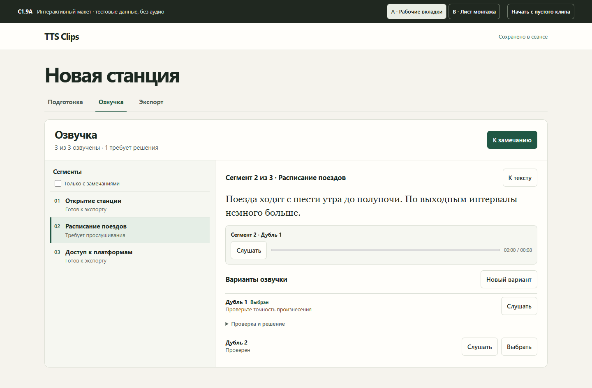
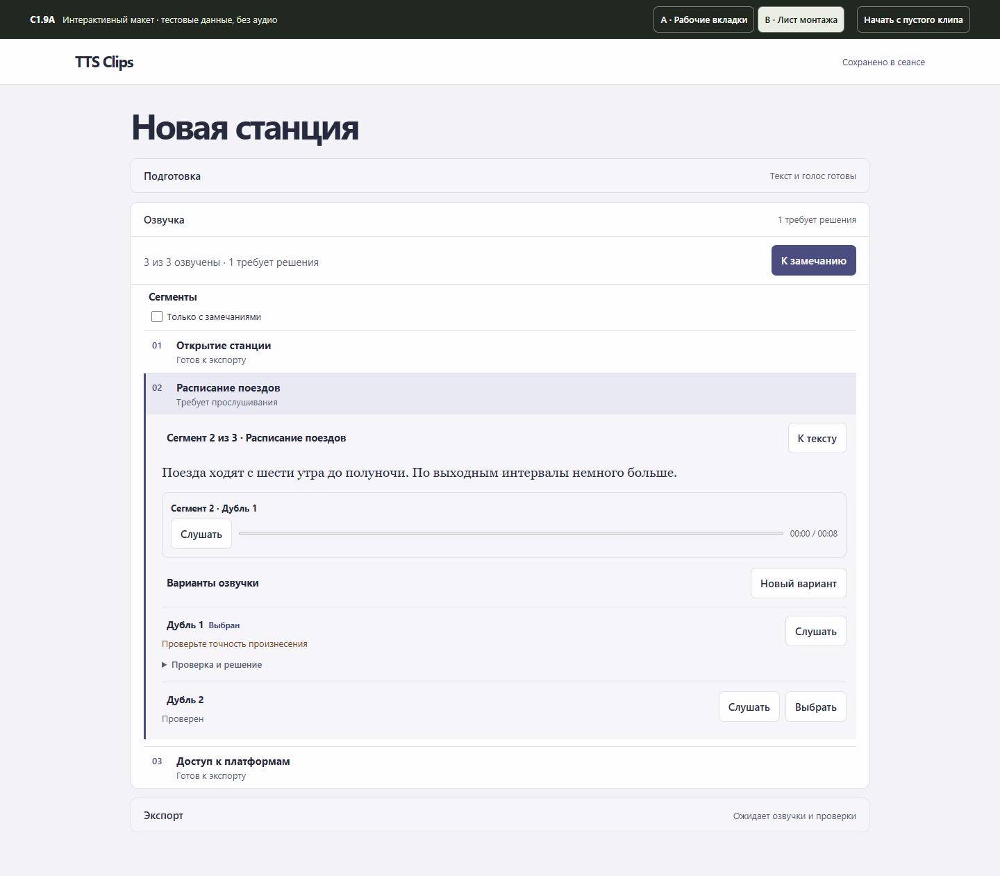

# C1.9A. Предложение по редизайну TTS Clips

**Рекомендация к согласованию — A. Рабочие вкладки.** На широком экране список сегментов остаётся рядом с плеером. На узком экране открытая реплика, плеер и решения собраны в одном блоке. Во всех размерах «Подготовка», «Озвучка» и «Экспорт» доступны в любом порядке.

Целевой пользователь — монтажёр, которому передали готовый русский перевод. Его первая задача — вставить материал, выбрать голос, озвучить текст, разобрать замечания и получить MP3 без обучения. Основание — [C1.7](C1.7_Pilot_and_UX_Audit.md), [C1.8](C1.8_Speech_Ready_and_Integrity_Validation.md) и реализация `origin/main` на `f8b0ce3`. Изменения этого предложения находятся в `docs/`.

## Просмотр макетов

Откройте [интерактивный макет](mockups/c1.9a/index.html) в браузере из локального checkout. Файл можно открыть напрямую. Если браузер блокирует локальные файлы, выполните из корня репозитория:

```powershell
py -3 -m http.server 8795 --bind 127.0.0.1 --directory docs/mockups/c1.9a
```

Перейдите на [экран макета](http://127.0.0.1:8795/). Переключатель A/B в верхней тёмной полосе сравнивает **концепции** и относится только к макету. Кнопка «Начать с пустого клипа» сбрасывает демонстрацию. Суффиксы `#a/work`, `#b/work`, `#a/prep`, `#b/prep`, `#a/export` и `#b/export` открывают заданные состояния. Макет показывает ход воспроизведения, синтеза и сборки на тестовых данных. Кнопки скачивания демонстрационные.

| Концепция | Широкий экран, 1440 px | Узкий экран, 390 px |
| --- | --- | --- |
| A · Рабочие вкладки | [Озвучка](mockups/c1.9a/a-wide.png) · [Подготовка и голос](mockups/c1.9a/a-prep-wide.png) | [Озвучка](mockups/c1.9a/a-narrow.png) · [Экспорт](mockups/c1.9a/a-export-narrow.png) |
| B · Лист монтажа | [Озвучка](mockups/c1.9a/b-wide.png) · [Экспорт](mockups/c1.9a/b-export-wide.png) | [Озвучка](mockups/c1.9a/b-narrow.png) · [Подготовка и голос](mockups/c1.9a/b-prep-narrow.png) |

Широкие и узкие макеты сняты на областях просмотра 1440 × 900 и 390 × 844 с прокруткой всей страницы. Демонстрационные сценарии пройдены в Chrome для обеих концепций. Проверены ручное решение, блокировка выпуска, черновая сборка, выделение реплики и числового замечания после эмодзи, подтверждение синтеза и сохранение выбора при смене проигрываемого дубля. Горизонтальной прокрутки не было на проверенных экранах при 390 px и в состоянии подготовки при 320 px. Пользовательская приёмка с монтажёрами относится к следующему этапу.

## Концепция A. Рабочие вкладки



Под названием клипа постоянно видны три вкладки. На ширине от 900 px в «Подготовке» редактор и голос стоят рядом. В «Озвучке» слева остаётся список сегментов с готовностью текущего выбора, справа видны номер и текст активной реплики, один плеер и дубли. В «Экспорте» параметры и результат можно сверить рядом. Библиотека клипов открывается из шапки и доступна в любой вкладке.

На узком экране сохраняется одна колонка и те же три вкладки. В «Озвучке» сворачиваемый список показывает активный сегмент в закрытом виде. После выбора список сворачивается, фокус переходит к заголовку реплики и плееру. В «Подготовке» голос идёт после текста и результата проверки. В «Экспорте» препятствия и параметры идут перед плеером и скачиванием. Макет пробует переход в одну колонку при 700 px. Порог 900 px — стартовая гипотеза для реализации, проверить на ширинах 768 и 900 px.

**Первый клип.** В библиотеке нажать «Новый клип». На вкладке «Подготовка» вставить перевод и увидеть положительное сообщение о письменных формах или перейти к замечанию. Выбрать сохранённый голос либо создать пробу, прослушать и нажать «Использовать». Затем открыть «Озвучку» и нажать «Озвучить недостающие». Для тестового клипа выбрать «К замечанию»: сегмент 2 выделяется слева, плеер и его варианты открываются справа либо сразу под номером сегмента на узком экране. Прослушать дубль, принять его после сверки или выбрать пригодный второй. Открыть «Экспорт», собрать MP3, прослушать полный клип и скачать файл. К тексту можно вернуться из любой вкладки; ссылка из инспектора выделяет активную реплику.

## Концепция B. Лист монтажа



Три раскрываемых раздела идут сверху вниз. У каждого закрытого раздела остаётся краткий результат. Озвучка организована как список реплик. Плеер и варианты открываются внутри строки выбранного сегмента. Контекст читается сверху вниз, а соседние сегменты видны до и после открытой строки.

На узком экране сохраняется порядок листа. Активная строка раскрывает текст, плеер и решения в своём месте. Действие в сводке экспорта раскрывает нужный сегмент и приводит фокус к его заголовку. При возврате свёрнутые разделы и открытая строка сохраняют контекст. В интерактивном макете одновременно открыт один рабочий раздел, чтобы показать объём прокрутки.

**Первый клип.** Создать клип, раскрыть «Подготовку», вставить перевод. В этом же разделе выбрать голос или воспользоваться пробой. «К озвучке» сворачивает подготовку с итогом и раскрывает озвучку ниже. Запустить недостающие. Нажать строку 2 и поочерёдно прослушать дубли в появившемся там плеере. После принятия или смены выбора сводка «Экспорт» меняется на «Можно собрать». Раскрыть её, собрать, прослушать и скачать MP3. Если экспорт закрыт блокировкой, «Открыть сегмент» переносит к нужной строке. Подготовка доступна через её заголовок в любой момент.

| Критерий | A · Рабочие вкладки | B · Лист монтажа |
| --- | --- | --- |
| Связь звука и текста | Заголовок одной реплики рядом с закреплённым списком | Плеер раскрывается непосредственно в строке |
| Первый короткий клип | Очевидный переход по вкладкам, плотнее раскрывается озвучка | Наглядный порядок и видимые итоги соседних разделов |
| Возврат к прежней реплике | Постоянное место списка на широком экране | Открытая строка меняет длину листа, фокус и прокрутку нужно восстанавливать |
| Длинный материал | Несколько просмотров без смены положения других сегментов | Несколько длинных раскрытий усложняют навигацию и сравнение позиций |
| Узкий экран | Список доступен по кнопке, открытая реплика занимает основную область | Контекст соседней строки виден, переход от подготовки к экспорту длиннее |

A рекомендован для повторяющихся правок, нескольких дублей и клипов с большим числом сегментов. B сохраняет преимущество для линейного просмотра короткого материала. Обе концепции сохраняют одинаковые операции и правила допуска. Для выбора между ними важнее скорость разбора замечаний и возвращения к тексту, чем визуальная тема.

## Единое поведение

### Навигация и воспроизведение

- Вкладки или раскрываемые заголовки доступны с начала. В пустом экспорте есть действие «К озвучке», в пустой озвучке — «К подготовке». Работа очереди, автосохранение, активный сегмент и набор отмеченных целей относятся к клипу, а не к открытому экрану.
- Активный сегмент показывает номер и точный текст. Номер повторяется в подписи плеера и в предупреждении экспорта. «К тексту» использует сохранённый диапазон актуальной редакции. При смене клипа, сегмента или этапа воспроизведение останавливается; в том же сегменте кнопка другого дубля меняет источник в общем плеере и начинает этот дубль с начала.
- «Слушать» управляет плеером, «Выбрать» меняет источник **для сборки**, «Принять» фиксирует решение после прослушивания. Данные трёх операций различны. Текущий выбор помечается отдельным словом «Выбран». Прослушивание и создание нового дубля выбор не меняют. Обычное автоматическое назначение первого готового дубля и возможность вернуть предыдущий выбор сохраняются.
- Решения и замечания открываются в «Проверка и решение». При проблемном дубле показывается конкретная причина и действие. В технической части — полный и хвостовой транскрипты, покрытие, версии, параметры, seed и происхождение. Принятие использует существующую отметку «Прослушал» и явную команду. Состояние воспроизведения её не подменяет.

### Один основной статус дубля

Строки ниже применяются сверху вниз. Готовность **сегмента** зависит от фактического выбора, готовность **клипа** — от серверного плана экспорта. «Проверен» описывает автоматическую проверку дубля, «Готов к выпуску» в экспорте требует актуального плана.

| Приоритет | Данные | Текст пользователю и действие |
| --- | --- | --- |
| 1 | Старый голос или материал либо отсутствующий/невалидный WAV | «В истории» либо «Запись недоступна». История доступна для чтения и воспроизведения доступного файла; текущий сегмент можно озвучить заново. |
| 2 | Отмена, прерывание, ошибка синтеза | «Остановлен», «Прерван» или «Не удалось озвучить». Повторить выбранное, готовые результаты остаются доступны. |
| 3 | Задание синтеза в очереди или выполняется | «В очереди» или «Озвучивается». В строке операции доступна остановка. |
| 4 | Дубль отклонён либо явно принят после прослушивания | «Отклонён» либо «Принят». Решение имеет приоритет над автоматическими замечаниями; подробности QC сохраняются. |
| 5 | Есть WAV, QC в очереди или выполняется | «Проверяется». Прослушивание доступно. |
| 6 | Актуальный значимый лексический флаг | «Проверьте точность произнесения». Сверить фрагменты и принять либо выбрать другой допустимый дубль. |
| 7 | Полнота `likely_defect` или `suspect`, либо есть препятствие проверки восстановленного дубля | «Возможен пропуск речи» либо «Требует прослушивания». Причины в деталях, восстановление только для источников, которые допускает действующая логика. |
| 8 | QC не запускался, устарел, недоступен или завершился ошибкой; integrity `unassessed` | «Ещё не проверен», «Нужно проверить снова», «Проверка недоступна» или «Ошибка проверки». Повторить проверку либо принять после прослушивания. Для устаревших оснований использовать код плана экспорта. |
| 9 | Полнота `verified` и лексический результат `clear` | «Проверен». При воспроизведении не дублировать статусом «Прослушан». Последний остаётся атрибутом в решении. |

Если одновременно есть значимое лексическое замечание и возможный пропуск, показывается один основной статус, обе причины перечисляются внутри. Прогресс новой проверки может временно заменить прежний статус, прежний результат остаётся в деталях. При клике на препятствие экспорта раскрывается текущий выбранный дубль конкретного сегмента. Новая версия материала блокирует старый план, прежние файлы остаются в истории.

### Голос

«Создать голос» открывает ближайший к выбору голоса блок с двумя сценариями.

- **По описанию.** Пресеты «Спокойный диктор», «Спокойный репортаж» и «Нейтральный рассказчик» подставляют английское описание. Например, «Спокойный диктор» — `Calm Russian narrator, clear articulation, measured pace.` Английский рекомендован для описания, произносимая фраза остаётся русской. «Описание и расширенные настройки» раскрывает редактирование описания, seed с текущим значением по умолчанию и при необходимости имя сохраняемого голоса.
- **По образцу WAV.** Показать требования к WAV рядом с выбором файла (до 30 секунд и 16 МиБ), короткую русскую фразу и настройку seed в раскрываемом блоке. Для обеих проб подставить безопасную редакторскую фразу, доступную для правки, в пределах текущего API.
- После «Создать пробу» показывать состояние задания и остановку. В готовой пробе у плеера указать источник. После «Прослушать» действие «Использовать» сохраняет пробу с именем по умолчанию из пресета либо «Голос по образцу» и назначает её текущему клипу. Имя можно задать до сохранения в раскрываемых настройках. Если голос уже закреплён, использовать его ID. Если закрепление прошло, а назначение конфликтует с другой редакцией, показать, что голос сохранён, и предложить выбрать его в актуальной версии. История проб доступна отдельно внутри создания голоса.

### Подсказки и ошибки

| Состояние | Подсказка и следующее действие |
| --- | --- |
| Библиотека пуста | «Создайте клип и вставьте готовый русский перевод». «Новый клип». |
| Новый клип, текста нет | «Вставьте готовый русский перевод». После автосохранения появляются сегменты. |
| Проверка текста чистая | Постоянный результат «Текст готов к озвучке · письменные формы не найдены». Значение ограничено проверяемыми правилами. |
| Письменные формы остались | Показать фрагмент и причину. Клик выделяет диапазон с Unicode; при попытке синтеза подтвердить команду или вернуться к правке. |
| Голоса нет | «Выберите голос или создайте пробу». Ошибка WAV объясняет допустимый формат, длительность и размер рядом с полем. |
| Задание долго выполняется | «Озвучиваем» или «Проверяем запись». Показать завершённый объём и «Остановить» для активной операции. |
| Все выбранные дубли пригодны | «Можно собрать клип» в озвучке. В экспорте «Готов к выпуску» и кнопка «Собрать MP3» после получения плана без препятствий. |
| Есть препятствие | «Сегмент 2 · проверьте точность произнесения» и переход в этот сегмент. Черновик допустим по текущим правилам с сохранением предупреждения. |
| MP3 не получен, WAV готов | «WAV готов. MP3 собрать не удалось». Показать скачивание WAV и возможность повторно собрать MP3 из существующих дублей. |
| Сеть, ошибка сохранения, конфликт | Сообщение рядом с действием, сохранить ввод и предложить повтор, загрузку серверной версии или явное сохранение своей. Повтор отправки команды использует тот же ключ, новая генерация — новый. |

В каждом состоянии одна визуально главная команда, обычные переходы и вторичные действия нейтральны. Подсказка сохраняется до смены соответствующего состояния. Ошибки не исчезают при переходе, если причина остаётся. Прогресс объявляется через ненавязчивый `role=status`, ошибки сохранения и выполнения — через `role=alert`. В операционных сообщениях использовать «озвучка», «проверка записи», «восстановить речь». Названия VoxCPM2, Whisper и параметры распознавания доступны в технических деталях или в подсказке о настройке, если без них невозможно устранить ошибку.

## Матрица функций

| Сейчас | В обеих концепциях | Ограничение или сохранённый контракт |
| --- | --- | --- |
| Библиотека, новый клип, заголовок, автосохранение, конфликт | Библиотека из шапки, заголовок и состояние сохранения рядом с этапами; диалог конфликта | Остаются идентичность сегментов, редакции и ручное разрешение конфликта. |
| Редактор, сегменты, готовность текста | «Подготовка», список замечаний; переход из «Озвучки» к реплике | Один текст, точные диапазоны, положительный результат; подтверждение предупреждений относится к фактическим целям. |
| Выбор голоса, Design/Clone, история проб, сохранение | «Голос клипа», «Создать пробу → Слушать → Использовать», внутри история и расширенные настройки | Прежние preview, pin, ревизия клипа, загрузка WAV, ошибки и отмена. Пресет подставляет строку описания. |
| Недостающие и выбранные сегменты | «Озвучить недостающие» основная; «Выбрать сегменты» открывает флажки и «Озвучить выбранные» | Фокус строки и пакетная отметка независимы, сохраняются прогресс, остановка и идемпотентность. |
| Плеер дубля, отдельные слоты A/B | Единый плеер активной реплики, из строк дублей «Слушать» | Последовательное сравнение двух или более WAV; смена источника без смены текущего выбора. |
| Выбор, вернуть предыдущий, прослушал, принятие, отклонение, заметки | «Выбран» и «Выбрать» рядом с дублями; «Вернуть предыдущий» и решения в раскрытии | Сохранены три разных понятия: воспроизведение, выбор, ручное решение. |
| Повтор, новый seed, история других редакций и голосов | «Новый вариант», «Повторить с теми же параметрами» в меню дубля, «История» в озвучке | Дубли неизменяемы. В истории прежние файлы и решения. Seed и происхождение в деталях. |
| Полнота, лексическая точность, повтор QC и фильтр | Статус; в деталях «Проверить снова», ожидаемый, распознанный текст и обе причины; «Только с замечаниями» по сегментам | Фильтр скрывает строки без проблем текущего выбранного дубля, детали всех дублей доступны в открытом сегменте. Результаты QC сохраняются. |
| Recovery с `likely_defect`, включить `suspect`, отмена, история частей | «Восстановить речь» у допустимого дубля, пакет в действиях списка, расширенное «Включить сомнительные» | Действующие условия доступности, ограничения попыток, части и причины. Лексическое замечание само по себе не запускает Recovery и не подменяет выбор. |
| Проверка плана, режим, формат, паузы и состав | «Экспорт», готовность и переход к препятствию, «Собрать MP3» или «Собрать WAV», «Паузы и состав» | Серверный план остаётся источником истины. Черновик с предупреждениями. Режим выпуска не обходится через UI. |
| Плеер клипа, скачивание WAV/MP3, история | Результат справа или ниже параметров, история под ним | Один полный плеер. Исторический снимок подписан и скачивается независимо от текущих блокировок. |

## План реализации A после согласования

1. **Навигация и модель экрана.** Развести этапы в React, сохранив один источник состояния клипа и отдельные состояния активного сегмента, отметок и раскрытий. Задать правила восстановления фокуса после переходов, автосохранения и конфликта. Подключить библиотеку в шапку. На узком экране проверить доступность всех элементов мышью, касанием и Tab.
2. **Подготовка и голос.** Перенести редактор, результаты `speech_ready` и выбор голоса. Дать положительный итог и безопасные переходы к диапазонам. Добавить пресеты и связать `POST /api/previews/design` или `/clone`, существующий опрос задания, `POST /api/voices` и сохранение `voice_id`. Покрыть отказ, остановку, повтор отправки, повторное использование закреплённой пробы и конфликт редакции.
3. **Озвучка и решения.** Переиспользовать текущие команды `generations`, `recoveries`, `take-selection`, `review` и `qc`. Собрать один компонент-адаптер пользовательских статусов с табличными тестами приоритетов. Перенести существующие аудио URL в один плеер. По номеру сегмента открывать контекст из списка, фильтра и препятствия экспорта. Сохранить историю и операции расширенного режима.
4. **Экспорт.** Запрашивать `export-plan` при открытии и при изменении состава, решения, QC, режима или параметров. Отбрасывать устаревшие ответы, после ошибки публикации показывать актуальный план. Передавать неизменённый `plan_id` в существующий `POST /api/clips/{id}/exports`. В интерфейсе сохранять стабильное место готового результата и отдельно отмечать прежний снимок. Состояние MP3 с готовым WAV проверять отдельно.
5. **Регрессия и приёмка.** Прогнать backend-тесты и сборку, затем проверить обе ширины на изолированной копии базы с существующими реальными WAV. Снять экранные состояния до/после синтеза, при лексическом флаге, проблеме файла и успешном экспорте. После функциональной регрессии дать первый клип монтажёрам для самостоятельного прохождения.

### Критерии пользовательской приёмки

- Пять монтажёров, впервые открывших TTS Clips, получают одинаковый подготовленный русский перевод. Минимум четверо самостоятельно скачивают MP3 и показывают, как вернуться к тексту, без README, устной подсказки и обхода предупреждений. Цель времени — до пяти минут активной работы, ожидание GPU и QC замеряется отдельно. Отдельно пройти сценарии с сохранённым голосом и с созданием пробы.
- На тестовом сегменте с двумя дублями монтажёр определяет, какой дубль сейчас играет, какой выбран для сборки и нужен ли допуск. Переключение звука ни разу не меняет выбор. Пользователь может пройти от лексической блокировки к точному сегменту и устранить её через реальное ручное решение либо явный выбор другого допустимого дубля.
- Узкий экран от 360 px и широкий от 1024 px позволяют выполнить те же сценарии. При 320 px проверить отсутствие горизонтальной прокрутки и сохранение читаемости. С клавиатуры доступны этапы, список, плеер, выбор, раскрытия и экспорт. Выделение текста и фокус остаются предсказуемыми.
- Положительный результат виден после сохранения, готовности текста, завершения синтеза и успешного плана. Проверить ошибки загрузки, синтеза, QC, конфликта, повреждённого WAV и недоступного MP3 с готовым WAV.
- Финальный экспорт требует действующего серверного допуска. Черновик содержит предупреждения. Смена вкладки, перезапуск, новая редакция и новый дубль сохраняют прежние WAV, выборы для неизменившегося материала, результаты QC и исторические экспорты. Проверка проводится на копии базы.

К согласованию предлагаются схема A, тексты основных статусов и расположение расширенных действий. Синтез, алгоритмы QC и формат экспорта рассматриваются как действующие контракты.
